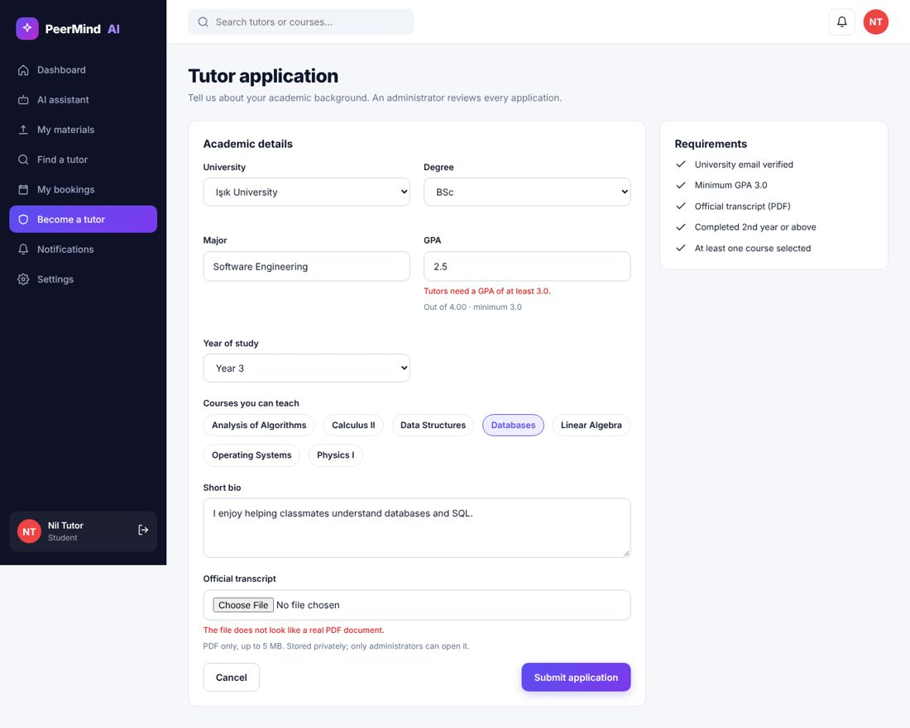
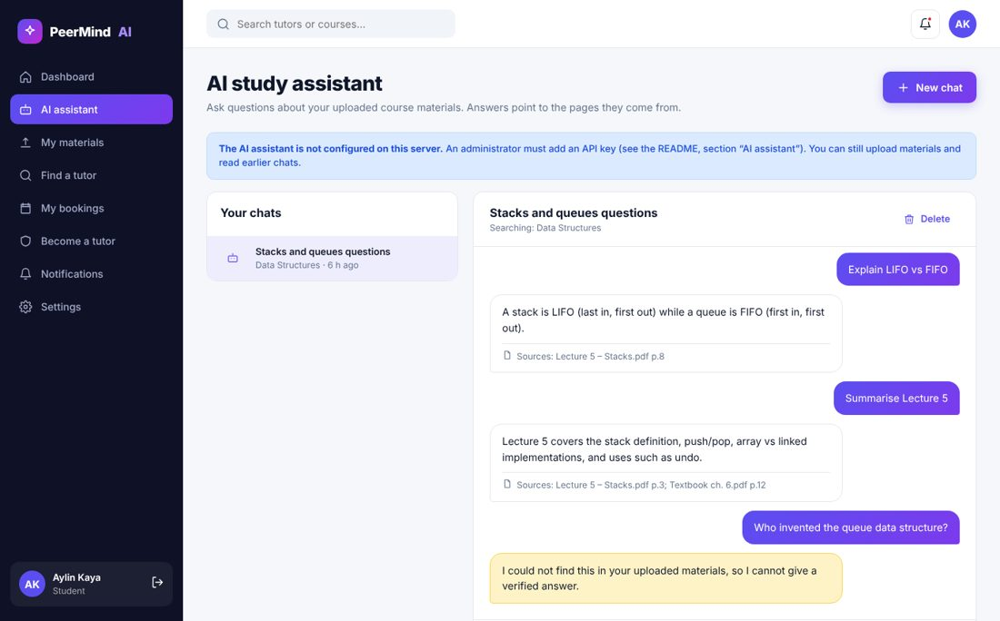
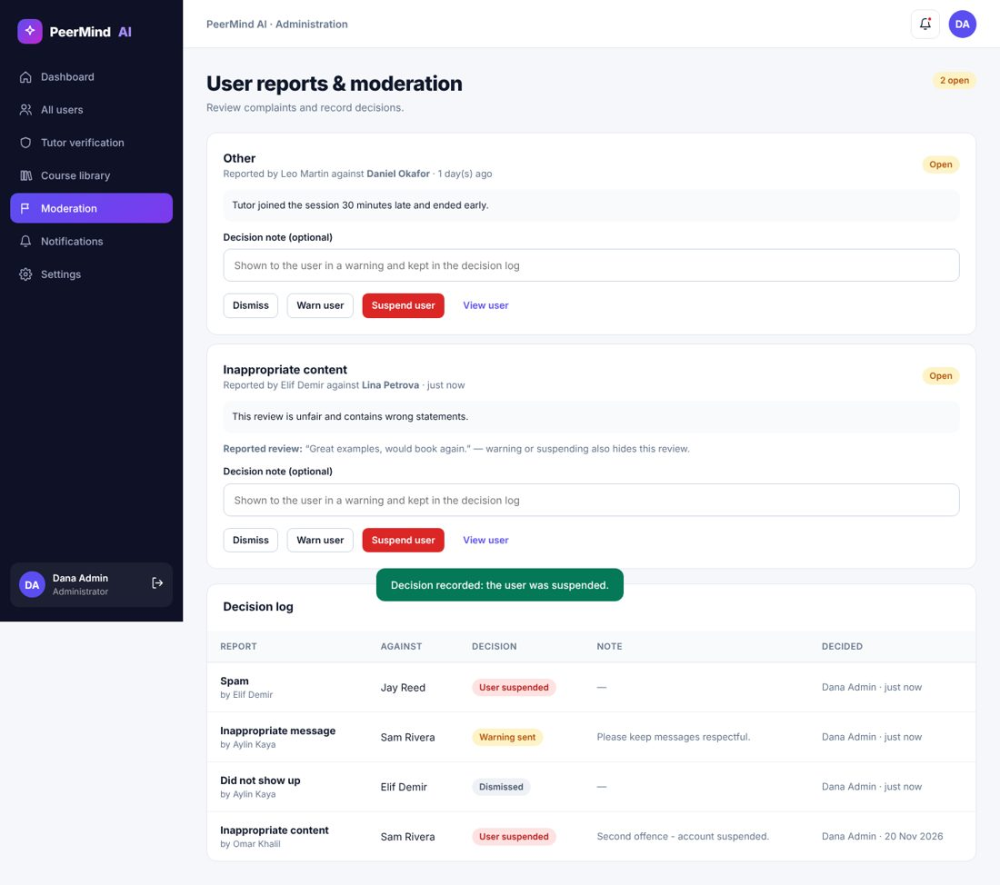
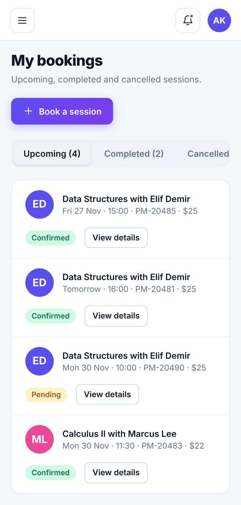

**Group:** Ali Kanjo (23COMP1065), Ammar Azzan (22COMP1048), Kenan Aljabi (21COMP1073)\
**Test date:** 28 November 2026\
**Version tested:** `main` branch of <https://github.com/AliKanjo/perrMindAI>

## 1. Scope and approach

The tests cover the two main workflows (booking a tutor, becoming a tutor), the AI study assistant, accounts and passwords, the admin features, error handling, security and small screens. Every test case is in one of four groups:

- **Normal operation**: a user does what the feature is meant for.
- **Invalid input**: wrong, missing or malicious data, checked in the browser *and* on the server.
- **Exceptional situations**: conflicts, failures of other systems, and rules that block an action.
- **Security**: access control and protection of data.

Most test cases were run **automatically** with three browser test scripts (Playwright driving Chromium), which click through the real application and check the result on screen and in the database. The scripts are in `tests/browser/` and can be re-run (see the README in that folder). A few cases need the environment to change (stopping the database, removing the AI key) and were run **manually** with a helper script. The database was re-imported before each script, so every run starts from the same demo data.

**Test environment:** Ubuntu 24.04, .NET SDK 8.0.134, MariaDB 10.11.14, Chromium (Playwright). Phone and tablet tests used the iPhone 13 and iPad (7th gen.) browser profiles.

**About the AI tests:** the AI tests used a local stand-in for the Claude API (`tests/browser/fake-claude.js`). It answers in the same format as the real API, rejects requests without the right key and version header, and can simulate an error, a time-out and an "I cannot answer" reply. This makes the tests repeatable and free. The real Claude API was not called during testing because no API key was available in the test environment; test case TC-38 is the check the team must do with a real key before the presentation.

## 2. Summary

| Group | Test cases | Passed | Failed | Not run |
|---|---|---|---|---|
| Normal operation | 14 | 14 | 0 | 0 |
| Invalid input | 10 | 10 | 0 | 0 |
| Exceptional situations | 8 | 8 | 0 | 0 |
| Security | 5 | 5 | 0 | 0 |
| To be run with a real API key | 1 | – | – | 1 |
| **Total** | **38** | **37** | **0** | **1** |

The three automated scripts ran **115 individual checks, and all 115 passed**: 47 for the Project #3 workflows, 20 for moderation and 48 for the Project #4 additions. They found no JavaScript errors in the browser and no unhandled errors in the server log. Defects found while testing were fixed before this final run (see section 4).

## 3. Test cases

### 3.1 Normal operation

| ID | Functionality | Input / actions | Expected result | Actual result | Result |
|---|---|---|---|---|---|
| TC-01 | Log in | Log in as `aylin.kaya@university.edu` with the correct password. | The student dashboard opens. | The student dashboard (`/student`) opened with Aylin's sessions. | Pass |
| TC-02 | Registration and e-mail verification | Register "Nil Tutor" with `…@isikun.edu.tr`, a strong password and "Tutor"; click *Verify my email*. | The account is created, verified and logged in; the tutor application opens. | Verification page shown, then `/tutor/application` opened with the user logged in. | Pass |
| TC-03 | Tutor search without page reload (Fetch + JSON) | Open *Find a tutor*; choose the course "Databases"; type "Elif". | Results update without reloading; Databases shows 2 tutors; "Elif" shows 1. | All 7 approved tutors listed; the filters updated the list in place to 2 and then 1 tutor. | Pass |
| TC-04 | Book a session | On Elif Demir's profile pick the first free slot, course "Data Structures", topic "E2E test topic"; click *Request booking*. | The booking is saved as Pending, the price is shown, the booking page opens with a message. | Total showed "$25 (60 min)"; booking PM-20019 opened with status Pending and the message "Booking request sent". | Pass |
| TC-05 | Tutor accepts a request (Fetch) | As Elif, open *Booking requests* and click *Accept* on the new request. | The status changes to Confirmed on the same page; the student is notified. | The card's badge changed to Confirmed without a reload; a toast confirmed it. | Pass |
| TC-06 | Complete a session and review it | As the tutor, click *Mark as completed* on yesterday's session. As Aylin, rate the completed session with Mei Tanaka 5 stars with a comment. | The session becomes Completed; the review is saved and shown. | The status changed to Completed in place; the booking page showed "rated 5 out of 5". | Pass |
| TC-07 | Tutor application and approval (Workflow 2) | As the new user, submit the application with GPA 3.6, the course Databases and a PDF transcript. As the admin, open it, download the transcript and click *Approve*. | The application becomes Pending, then Approved; the user gets the Tutor role and appears in the tutor search. | Status page showed "under review"; the admin downloaded the PDF; after approval the user opened `/tutor` and appeared in the Databases search. | Pass |
| TC-08 | Course library CRUD (admin) | Create course `TST…` "Test Course", edit its name, then delete it. | The course appears, its new name is shown, then it disappears. | All three changes were shown in the list with a success message each. | Pass |
| TC-09 | Change password | On the profile page enter the current password and a new strong password twice. | The password changes; the old one stops working, the new one works. | "Your password was changed."; log-in with the old password failed, with the new one succeeded. | Pass |
| TC-10 | Forgot password | On *Forgot password?* enter Aylin's e-mail; open the reset link; set a new password; log in. | A reset link is "e-mailed" (written to the terminal in this demo); the new password works. | The link appeared in the server log; the new password was saved and the log-in succeeded. | Pass |
| TC-11 | Upload course material | On *My materials* choose "Data Structures" and upload a 2-page PDF with text. | The PDF is stored privately and its text is read page by page. | "2 page(s) were read"; the file is listed as Ready and can be switched on and off as an AI source. | Pass |
| TC-12 | Ask the AI assistant | Start a new chat and ask "How are collisions resolved in a hash table?"; reload the page. | An answer appears without a reload, with references to the pages used; the chat is saved. | The answer named "Lecture 9 - Hash tables.pdf, p.1" and listed its sources; after reload the chat was still there. | Pass |
| TC-13 | Moderation (admin) | Decide three reports: dismiss one, warn Sam Rivera with a note, suspend the author of the spam review. | Each decision is recorded; the warned user is notified; the suspended user cannot log in; the reported review is hidden and the tutor's rating is recalculated. | All three appeared in the decision log; Jay Reed could no longer log in; Elif's reviews went from 4 to 3 and her rating from 4.5 to 4.7. | Pass |
| TC-14 | Use on small screens | Open the site on a phone and a tablet; use the menu button to navigate; open every student and admin page. | A menu button replaces the sidebar; no page needs sideways scrolling. | The menu opened and navigated to *My bookings*; no student page (phone) or admin page (tablet) scrolled sideways. | Pass |

### 3.2 Invalid input

| ID | Functionality | Input / actions | Expected result | Actual result | Result |
|---|---|---|---|---|---|
| TC-15 | Log in with a wrong password | Correct e-mail, wrong password. Also submit the empty form. | Log-in refused with a message that does not say which part was wrong; empty fields are flagged before sending. | "Incorrect e-mail or password."; the empty form showed "Please enter your e-mail address." | Pass |
| TC-16 | Registration with a personal e-mail | Register with `someone@gmail.com` (the browser cannot know the allowed domains). | The server refuses it. | The stored procedure refused it: "Only university e-mail addresses are accepted." | Pass |
| TC-17 | Weak or mismatched passwords | Register with "short" and a different confirmation; change the password to "weakpassword"; reset with two different passwords. | Each form explains the rule and nothing is saved. | Messages for the length, the character rule and "The two passwords do not match." were shown; no password changed. | Pass |
| TC-18 | Tutor application rule checks | GPA 2.5, no course selected, then a text file renamed to `.pdf`. | The missing course is flagged in the browser; the server rejects the low GPA and the fake PDF. | "Please select at least one course…"; then "Tutors need a GPA of at least 3.0." and "The file does not look like a real PDF document." | Pass |
| TC-19 | Duplicate course code | Create a course with the existing code `comp2112`; also submit an empty course form. | The empty form is flagged; the duplicate is refused by the database. | "Please enter the course code."; then "A course with this code already exists." | Pass |
| TC-20 | Overlapping availability | As a new tutor, add 10:00–11:00, then 10:30–11:30 on the same day. | The second slot is refused. | "This time overlaps another of your slots." | Pass |
| TC-21 | Incomplete booking and review forms | Click *Request booking* without a slot; submit a review without stars; enter a negative hourly rate. | Each form is stopped with a clear message. | "Please pick a time slot.", "Please choose a rating.", "The hourly rate must be between 0 and 500." | Pass |
| TC-22 | Invalid material uploads | Upload a `.txt` file; a text file renamed to `.pdf`; a PDF that contains only an image. | The first is stopped in the browser, the second by the server; the third is stored but marked as having no text. | "Please choose a PDF file."; "The file does not look like a real PDF document."; "No text was found in this PDF. Scanned documents … are not supported." | Pass |
| TC-23 | Invalid AI questions | Send an empty question; send a 501-character question directly to the server. | Both are refused; nothing is sent to the AI. | "Please type a question."; the server answered 400 "Questions can have at most 500 characters." | Pass |
| TC-24 | Invalid password-reset links | Open a reset link a second time; open a link with a made-up token. | Both show "This link is not valid" and allow requesting a new one. | Both showed the "not valid" page. | Pass |

### 3.3 Exceptional situations

| ID | Functionality | Input / actions | Expected result | Actual result | Result |
|---|---|---|---|---|---|
| TC-25 | Two students book the same slot (NFR-05) | After Aylin booked a slot, Can Özkan posts a booking for the same slot. | The second booking is refused; only one booking exists. | "This time slot is no longer available. Please choose another time." (unique key and transaction in the database). | Pass |
| TC-26 | Delete a course that is in use | Delete "Data Structures", which has bookings and enrolments. | It is hidden (deactivated) instead of deleted, so history is kept. | "The course is in use, so it was hidden instead of deleted." | Pass |
| TC-27 | Delete material used by a quiz | Delete "Lecture 5 – Stacks.pdf", which a quiz refers to. | The deletion is refused with an explanation. | "This material is used by a quiz or a roadmap lesson. Turn it off as an AI source instead of deleting it." | Pass |
| TC-28 | Question not covered by the materials (Scenario 2) | Ask "What is the best pizza topping?"; ask "Who invented the queue data structure?" (matches pages, but they do not contain the answer). | The assistant says honestly that the materials do not contain the answer instead of guessing; the first question does not use the AI at all. | Both got "I could not find this in your uploaded materials…", highlighted in yellow; the stand-in API received a request only for the second question. | Pass |
| TC-29 | AI service fails or is slow | The AI service returns an error (HTTP 500); then it takes longer than the time-out. | A friendly message; the question stays in the box to try again; nothing is saved; no technical details. | "The AI service returned an error. Please try again later." and "The AI service took too long to answer."; the question was kept; the page contained no error details. | Pass |
| TC-30 | AI key not configured *(manual)* | Start the application without an API key and open the assistant. | A notice explains the assistant is not configured; the question box is disabled; materials still work. | The notice was shown and the input was disabled. | Pass |
| TC-31 | Database stopped *(manual)* | Stop MariaDB, open *Find a tutor* and call the search directly; start MariaDB again. | A friendly error page (and a JSON message for background requests) without technical details; the site works again once the database is back. | Status 503 with "The database is not available…", JSON `{"ok":false,"message":"PeerMind AI could not reach its database…"}`; no stack trace or connection details; the page loaded normally after MariaDB restarted. | Pass |
| TC-32 | Suspended account | Log in as the suspended user `sam.r@university.edu`. | Log-in refused with an explanation. | "This account is suspended. Please contact support@peermind.ai." | Pass |

### 3.4 Security

| ID | Functionality | Input / actions | Expected result | Actual result | Result |
|---|---|---|---|---|---|
| TC-33 | SQL injection | Log in with e-mail `' OR '1'='1' -- @x.com` and password `' OR '1'='1`. | The log-in fails; the database is not affected. | The log-in was refused; all queries use parameters and stored procedures. | Pass |
| TC-34 | Access control between users and roles | Can Özkan opens Aylin's booking and AI chat by URL and posts a question into the chat; a student opens `/admin`; a tutor opens `/assistant`. | Other users' data is not found; pages of other roles are denied. | Booking and chat: 404; posting into the chat: 404; Can sees none of Aylin's materials; `/admin` and the tutor's `/assistant`: "Access denied". | Pass |
| TC-35 | Cross-site request forgery | Post a question to the assistant without the anti-forgery token. | The request is rejected. | HTTP 400; nothing saved. | Pass |
| TC-36 | Security headers | Request any page and inspect the headers. | Headers block framing and type-guessing and restrict where scripts come from. | `X-Frame-Options: DENY`, `X-Content-Type-Options: nosniff` and a `Content-Security-Policy` with `frame-ancestors 'none'` were present. | Pass |
| TC-37 | No account discovery through "forgot password" | Request a reset for an unknown e-mail and for a registered one. | The same answer for both, so nobody can find out which e-mails have accounts. | The two pages were identical apart from the e-mail typed. | Pass |

### 3.5 To be run with a real API key

| ID | Functionality | Input / actions | Expected result | Actual result | Result |
|---|---|---|---|---|---|
| TC-38 | AI assistant with the real Claude API | Put a real Anthropic API key in `appsettings.Local.json`, ask Aylin's chat "Explain LIFO vs FIFO". | An answer in plain language that cites the Lecture 5 or Syllabus pages. | – (no key in the test environment; the team runs this before the presentation) | Not run |

## 4. Defects found and fixed during testing

| # | Found by | Problem | Fix |
|---|---|---|---|
| 1 | Phone test | Below 1000 px the sidebar disappeared with nothing replacing it, so phones could not navigate. | Menu button with a slide-in sidebar; tables scroll inside their card. |
| 2 | Phone screenshots | On "My bookings" the text of each row was squeezed into a narrow column. | Rows wrap on phones: text beside the avatar, badge and buttons below. |
| 3 | TC-12 | The AI-access check compared a setting with text in SQL and failed with "Illegal mix of collations" when the database and connection collations differ. | The value is compared in C# instead. |
| 4 | TC-23 | When a page script handled a form itself, the shared script still showed "Please correct the highlighted fields", hiding the real message. | The shared script leaves such forms alone. |

## 5. Screenshots

::: keep
**Booking details after a successful booking (TC-04)**

:::

::: keep
**Server-side validation of the tutor application (TC-18)**

:::

::: keep
**AI assistant: answer with page references, honest "not in your materials" answers and a time-out message (TC-12, TC-28, TC-29)**

:::

::: keep
**AI key not configured (TC-30)**

:::

::: keep
**Database stopped (TC-31)**

:::

::: keep
**Moderation decisions (TC-13)**

:::

::: keep
**Forgot password: same answer for every e-mail (TC-10, TC-37)**

:::

::: keep
**Phone: menu and bookings list (TC-14)**

{ width=45% } { width=45% }
:::
